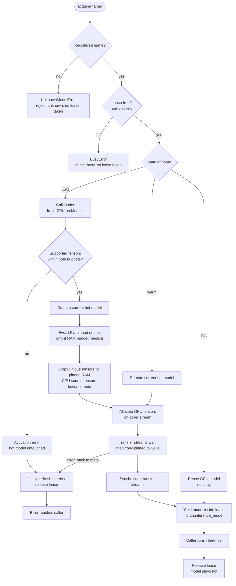

# Architecture: model-swapper

| Boundary | Contract |
|---|---|
| Inference models on the GPU per cache | One active model |
| Concurrent leases per cache | One; overlap raises `BusyError` |
| Model implementation | A caller-supplied CPU `torch.nn.Module` loader |
| Tensor state | Immutable, ordinary dense registered parameters/buffers |
| Native runtime | PyTorch on one CUDA device |

The cache manages **where model weights live**. It does not implement tokenization, generation, image processing or speech decoding. Those remain the caller's responsibility. It is not an API proxy or hardware GPU partition.

## Request flow

One `with cache.acquire(name) as model:` block, as implemented by `WarmCache.acquire`, `_activate`, `_prepare` and `_demote_hot` in [warm_cache.py](warm_cache.py). The application owns task inputs and `forward`/`generate`; the cache only decides where the weights live. The diagram is tall; use GitHub's diagram expand/zoom controls if labels render small.

Validation and copy failures are shown. Other activation or inference errors also release the lease through `finally`.

- **Refusals happen first.** An unregistered name is refused before the lease is touched, so it reports `unknown` even while another caller holds the lease. A held lease is an immediate `BusyError`, not a queue. Neither refusal acquires the lease, so neither has anything to release.
- **Hot reuse** returns the live GPU model with no copy and no checkpoint access.
- **Warm activation** never calls the loader. It demotes the current hot model, allocates GPU tensors and copies the retained pinned snapshot.
- **Cold activation** runs the loader and validates tensor support and logical GPU/RAM budgets **before** demoting the current hot model. A rejected model therefore leaves the hot model in place; the error is recorded and the lease is released in `acquire`'s `finally` before the error reaches the caller. Only after validation are least recently used pinned entries evicted, and only while the new snapshot would exceed the RAM budget. Evicted entries become cold.
- **Demotion** (`_demote_hot`) synchronises the device, then checks the hot model's bindings and module layout. Unchanged: tensors become `meta` and the pinned copy stays, so the model is warm. Changed: the snapshot and module are discarded, so the model is cold. Neither path copies GPU weights back to RAM. With `release_on_switch=True`, unused CUDA allocator blocks are then released.
- **Stream synchronisation.** Transfer streams wait for allocations made on the caller's current stream, copy asynchronously from pinned memory, and are synchronised before the model is yielded. If allocation or copying fails, the model returns to `meta` tensors and the same `finally` releases the lease before the error is raised to the caller.
- **Inside the lease** the caller uses the model under `torch.inference_mode()`. Readiness metrics are recorded before the yield, so they exclude caller inference. Leaving the block releases the lease even if metrics refresh fails; it does not demote the hot model.

## State transitions

```mermaid
stateDiagram-v2
    [*] --> Cold: register CPU loader
    Cold --> Hot: load, validate, pin, copy to GPU
    Hot --> Warm: unchanged model; another model needs GPU
    Warm --> Hot: copy retained pinned weights to GPU
    Warm --> Cold: RAM LRU eviction
    Hot --> Cold: close
    Hot --> Cold: registered bindings or module layout changed
    Warm --> Cold: close
```

HOT means one model has materialised GPU tensors. Its pinned CPU copy is retained. WARM means pinned weights and empty model structure remain, without that model's active GPU parameters. COLD means only the loader remains; checkpoint loading is needed again.

The warm cache's RAM budget includes the pinned copy of the hot model. The least recently used pinned entry is dropped when loading another model would exceed that budget. A model exceeding either logical tensor budget is rejected before allocating its pinned/GPU weights.

## Immutable snapshots avoid unnecessary copying

Inference does not change supported model weights. Once their CPU snapshot exists, there is no reason to copy them from GPU to RAM at each demotion. The cache frees the GPU tensors, keeps the model's empty structure, and restores from the original pinned copy later.

In-place weight edits remain unsupported. If a forward replaces/adds/removes registered tensor bindings or changes module layout, demotion discards that snapshot and module; the next request loads a fresh CPU model. This prevents dynamic rotary-position buffers from being combined with stale Python-side cache metadata. While a model remains hot, it keeps its live state.

Callers must not retain GPU tensor references or use the model after the lease ends. A loader must return a fresh, fully initialised CPU model, not an object previously handed to this cache.

## Tensor identity and compatibility

The initial snapshot includes both named parameters and named buffers with duplicate names retained. This includes non-persistent buffers, which `state_dict()` alone omits. Exact tied tensors are stored once and their aliases are reattached after restoration.

Bindings cache the owning module, attribute name and parameter/buffer kind. This avoids repeatedly walking module trees and resolving names during warm activation. GPU allocation is done once per unique tensor, rather than allocating tied embeddings twice and repairing them afterward.

Direct plain tensor attributes that exactly alias registered tensors are tracked as shadow bindings. They move to GPU during activation and to metadata-only tensors during demotion. Other plain tensors, tensor containers and opaque runtime caches are rejected. Weak references compare live tensor objects without relying on reusable Python object IDs or retaining old GPU allocations.

Each alias keeps its original registration kind. Rebinding writes the correct parameter or buffer dictionary, so a non-persistent buffer cannot accidentally become a parameter.

The cache explicitly rejects unsupported tensor/parameter subclasses, quantized tensors, sparse layouts, conjugate/negative views, non-CPU loader state, distinct views sharing storage, compiled/offload-hook modules and opaque cache state. Those cases can require custom runtime metadata or storage semantics that ordinary tensor replacement cannot preserve. They fail with `UnsupportedModelError` instead of silently changing the model.

“Model-agnostic” means the cache does not hard-code a causal-LM architecture. It does **not** mean every Python module or model engine is proven compatible. GGUF/llama.cpp, CTranslate2/faster-whisper and Strata are separate engines, not loaders for this interface. Tensor attributes used by `forward` must be registered state or supported direct aliases of it; arbitrary unregistered state is not migrated.

## Streams and allocator policy

Each activation allocates destinations on the caller's CUDA stream. Transfer streams wait for those allocations, copy from pinned RAM, and finish before the model is yielded. Demotion synchronises device work before replacing model tensors with metadata-only tensors.

`release_on_switch=False` retains PyTorch's reusable allocator blocks between switches. This can avoid repeated driver allocation/free calls. It also means CUDA memory reserved by the allocator can remain high while a model is not hot. Logical weight bytes and reserved CUDA bytes are different.

`release_on_switch=True` flushes unused allocator blocks after each demotion. It trades more allocation work for earlier release of unused reservations. Both policies release cache-owned model state and unused allocator blocks on `close()`.

One transfer stream is the conservative default. More streams cannot create PCIe bandwidth. The benchmark includes a two-stream variant so that its benefit, or lack of benefit, is measured rather than assumed.

Pinned preparation releases each CPU source tensor after its pinned copy is ready, rather than retaining two full host models through the entire copy. Loader work and transient allocations still sit outside the logical weight budget. PyTorch 2.5.1 rounds pinned allocations; the estimated rounded active bytes are exposed separately from logical tensor bytes.

Eviction and close flush unused host allocator blocks using `torch._C._host_emptyCache()`. This is a private API verified in the locked PyTorch 2.5.1 runtime. A PyTorch upgrade must recheck it. It operates on the process's unused pinned-memory cache, not on another process or still-referenced model data.

## Metrics

`metrics.py` owns a fresh `CollectorRegistry` for each cache. There is no global registry collision when an application creates multiple caches. The application can expose this registry with `prometheus_client.start_http_server`, or use `cache.metrics.render()` in its existing metrics endpoint.

| Metric | Meaning |
|---|---|
| `model_swapper_activations_total{model,source,outcome}` | Readiness attempts, split by cold/warm/hot source and success/error |
| `model_swapper_activation_duration_seconds{model,source,outcome}` | Time to make a model ready, excluding caller inference |
| `model_swapper_rejections_total{reason}` | Bounded `busy`, `unknown` or `admin_busy` rejections; unknown IDs do not become labels |
| `model_swapper_gpu_weight_bytes` | Logical unique tensor bytes of the hot model |
| `model_swapper_pinned_weight_bytes` | Logical retained pinned tensor bytes |
| `model_swapper_pinned_allocator_estimate_bytes` | Estimated active rounded host allocations; excludes unused cached blocks and page granularity |
| `model_swapper_process_cuda_allocated_bytes` | Current process's PyTorch-allocated CUDA tensor memory |
| `model_swapper_process_cuda_reserved_bytes` | Current process's PyTorch-reserved CUDA allocator memory |
| `model_swapper_gpu_weight_budget_bytes` | Configured logical GPU tensor budget |
| `model_swapper_pinned_weight_budget_bytes` | Configured logical pinned tensor budget |
| `model_swapper_models{tier}` | Registered entries in each state |
| `model_swapper_leases_active` | Whether a caller currently holds the lease |

Registered model IDs are bounded by the application. Do not put prompts, request IDs, paths or arbitrary user strings into metric labels. These memory gauges are not NVML process memory, CUDA context size or total host RSS. Histogram samples include startup/calibration whenever those activations pass through the cache; they are not automatically the benchmark's measured-only subset.

## Benchmark boundaries

`benchmark.py` loads two staged local Transformers causal LMs through the same backend and precision. It compares checkpoint reload, release-on-switch warm caching, allocator-reuse warm caching and allocator reuse with two transfer streams. Each method is calibrated before timed alternating activations. Every timed warm sample must actually start in the warm state; unexpected reloads abort the run. Output tokens and last-token logits must exactly match independently loaded references for the test prompt.

It records model and source hashes, timings, memory readings and raw samples. It can expose localhost-only metrics during warm methods and saves per-method Prometheus snapshots after cleanup. Data and profiling traces belong outside the repository.

The reload baseline allows the OS file cache and runs in one Python process. It is not a direct llama-swap measurement, physical cold-disk test, large-model scaling test or production concurrency benchmark. GPU sharing can affect timing. More model families passing output-parity tests establishes architecture coverage, not pretrained task accuracy.

## Deployment and safety

Nothing installs itself as a service. The benchmark's allocator fraction and free-memory guard are soft controls, not hardware isolation. The library's budgets exclude temporary activations, allocator rounding, CUDA context memory and Python objects.

The lease is released even if metrics cleanup fails. Secondary cleanup failures are attached to the original exception rather than replacing it. Fatal CUDA context errors, such as illegal memory access or driver loss, require a fresh process; the cache does not claim to recover a broken CUDA context.

Run experiments on a dedicated GPU where possible. Close the cache explicitly, keep model files and results outside Git, and verify the live environment before sharing a GPU. This library does not replace an application's serving engine or admission policy.
