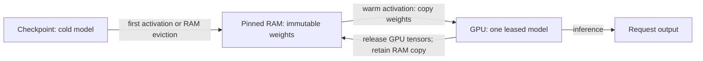

# model-swapper

| Verified on 2026-10-26 | Result |
|---|---|
| Real CUDA regression suite | 42 passing cases |
| Measured activations | 160; 20 per model/method pair |
| Actual warm restorations in that run | 120; no hidden checkpoint reloads |
| Correctness probes | All measured generated tokens and last-token logits matched independent loads exactly |
| Test hardware | V100 PCIe 32 GB, FP32, PyTorch 2.5.1+cu121 |

**Keep several supported PyTorch models in pinned CPU RAM and materialise one on the GPU at a time.** Switching skips checkpoint parsing and redundant GPU-to-CPU weight copies. This is an inference-only Python module and benchmark, not a production inference server or scheduler.



The last arrow describes a state transition, **not another GPU-to-RAM weight copy**. The CPU snapshot already exists. RAM pays for faster switching; the model must still fit the GPU together with its request's activations and cache.

See [ARCHITECTURE.md](ARCHITECTURE.md) for state transitions, tensor identity, cleanup, allocator policy and the complete metrics contract.

## Measured switching results

**Model readiness, median milliseconds; lower is better.** Same-process Transformers reload versus the same cache with three policies. V100 PCIe 32 GB, CUDA 12.1, driver 580.178.04, Python 3.12.3, Transformers 4.46.3, FP32/eager attention, two CPU threads, 2026-10-26.

| Model | Checkpoint reload | Warm, release unused GPU blocks | Warm, reuse GPU blocks — default | Reuse, two transfer streams |
|---|---:|---:|---:|---:|
| SmolLM2-135M-Instruct | 278.57 ms | 54.10 ms | **46.79 ms** | 46.85 ms |
| Pythia-70m-deduped | 227.72 ms | 52.04 ms | **37.42 ms** | 37.48 ms |

Allocator reuse reduced median readiness by **13.5% and 28.1%** against release-on-switch in this run. The two-stream option did not improve either model. The default therefore keeps one stream and reuses allocator blocks.

The cost is memory retention. Peak PyTorch-reserved GPU memory was 640 MiB with reuse versus 540 MiB with release. Both policies closed cleanly. Retained logical CPU weights totalled 805.79 MiB; estimated rounded active pinned allocations were 996.41 MiB. Peak process RSS reached about 2.50 GiB for warm methods versus 1.52 GiB for reload. These are different memory measurements, not interchangeable budgets.

A separate two-switch microprofile on the final source confirmed less driver allocation work:

| Policy | `cudaMalloc` calls | `cudaFree` calls | Async tensor copies |
|---|---:|---:|---:|
| Release on switch | 47 | 47 | 398 |
| Reuse allocator blocks | 0 | 0 | 398 |

This is a diagnostic profile, not another latency benchmark. Transfers still happen.

**Limits of the evidence:** two small pretrained causal LMs, one prompt, shared GPU, fixed method order after calibration, no production concurrency measurements. The baseline allows the OS file cache and includes the reload harness's garbage collection and allocator cleanup. These results do not establish large-model performance or task accuracy. The benchmark emits raw samples and source/model hashes; local run artifacts are not committed.

## Requirements and setup

- Linux x86-64, Python 3.12, NVIDIA CUDA-capable GPU and a driver compatible with CUDA 12.1.
- `uv`; dependencies and CUDA wheel source are pinned in `pyproject.toml` and `uv.lock`.
- Enough ordinary RAM **and locked/pinned RAM** for the snapshots. Logical tensor budgets are not process memory limits.
- Prefer a dedicated test GPU. An allocator fraction is a soft guard, not GPU isolation.

```bash
git clone https://github.com/shellnet68/model-swapper.git
cd model-swapper
uv sync --locked
uv run --locked python -m pytest -q
```

The suite requires real CUDA. It is not a CPU-only or mocked-transfer test suite. Instrumentation-failure tests inject metrics faults while keeping the model transfers real.

No GPU CI runner is configured for this new repository. The recorded suite ran on the V100 lab, not on a hosted CPU runner.

Run from the repository root. This project is not currently a packaged PyPI library or an HTTP serving engine.

## Small, runnable example

The loader returns a **fresh, fully initialised CPU `nn.Module`**. The cache puts it in evaluation/inference mode. All accesses to the GPU model belong inside its lease.

```python
import torch
from torch import nn
from warm_cache import WarmCache

MiB = 1024 ** 2
torch.set_num_threads(2)
# This caps this process's PyTorch allocator, not CUDA context or other processes.
torch.cuda.set_per_process_memory_fraction(0.05)
cache = WarmCache(gpu_budget_bytes=8 * MiB, ram_budget_bytes=16 * MiB)
cache.register("linear", lambda: nn.Linear(16, 4))
cache.register("mlp", lambda: nn.Sequential(nn.Linear(16, 8), nn.ReLU(), nn.Linear(8, 4)))
try:
    for name in ("linear", "mlp", "linear"):
        with cache.acquire(name) as model:
            result = model(torch.ones(1, 16, device=cache.device)).cpu()
        print(name, result.tolist())
finally:
    cache.close()
```

For a staged Transformers model, choose the correct task class in your own loader. No causal-LM class is hard-coded in the cache:

```python
from pathlib import Path
from transformers import AutoModel

encoder_path = Path.home() / ".cache" / "my-models" / "encoder"
cache.register("encoder", lambda: AutoModel.from_pretrained(
    encoder_path,
    torch_dtype=torch.float32,
    local_files_only=True,
    trust_remote_code=False,
    use_safetensors=True,
))
```

That loader example requires an already-staged compatible encoder checkpoint. Tokenization, preprocessing, batching, generation settings, request KV caches and HTTP APIs remain the application's job.

## What “any model” means here

The interface accepts supported `torch.nn.Module` implementations, not just text generators. It does **not** make every model engine compatible.

| Coverage | What was actually exercised |
|---|---|
| Pretrained causal LMs | SmolLM2-135M-Instruct and Pythia-70m-deduped; exact GPU reference token/logit agreement across measured switches |
| Other causal-LM architecture checks | Tiny Llama and GPTNeoX `generate()`; unchanged snapshots remain warm and outputs survive restoration |
| Embeddings | Tiny BERT; CPU/GPU output agreement across switches |
| Vision | Tiny ViT and Conv2d/BatchNorm network; CPU/GPU output agreement across switches |
| Speech architecture | Tiny randomly initialised PyTorch Whisper encoder-decoder; output agreement, **not** pretrained ASR quality or faster-whisper support |
| State invariants | Tied tensors, non-persistent buffers, parameter/buffer kinds, exact plain-attribute aliases, modified/removed/nullable bindings |
| Resource and error boundaries | GPU/RAM budgets, LRU eviction, busy/unknown requests, allocator policies, cleanup and metrics-failure lease recovery |

Tiny architecture tests establish state-handling coverage, not task quality or suitability of a particular large checkpoint. The pretrained benchmark used FP32; other precision/hardware combinations need their own parity and memory checks.

**Explicitly rejected:** custom tensor/parameter subclasses, packed/quantized tensors, sparse or conjugate/negative-view state, distinct views sharing storage, unregistered tensor containers, opaque runtime caches, compiled/offload-hook modules and non-CPU loader state. Exact tied tensors and supported direct aliases are different from partial shared-storage views.

**Outside this interface:** GGUF/llama.cpp, CTranslate2/faster-whisper, Strata, distributed tensor-parallel models, training, multi-GPU placement and concurrent model leases. Use an engine-specific integration rather than pretending those are ordinary interchangeable PyTorch weights.

Do not edit weights in place, resize state, train the leased model or keep GPU tensors after returning the lease. Detected structural/binding changes discard the stale snapshot and reload the model next time. That is a correctness fallback, not a warm-switch performance promise for state-changing models. Fatal CUDA context errors require a fresh process.

## Runtime metrics

Each cache owns an isolated Prometheus registry. Expose it on localhost, or return `cache.metrics.render()` from an existing application's metrics endpoint:

```python
from prometheus_client import start_http_server

server, thread = start_http_server(
    9416, addr="127.0.0.1", registry=cache.metrics.registry,
)
# Run your application's inference loop while the server is alive.
# On shutdown, after returning any active lease:
server.shutdown()
server.server_close()
thread.join(timeout=5)
cache.close()
```

This is an integration snippet: it uses the application's live `cache`. It does not install a daemon. The benchmark's `--metrics-port` creates this endpoint for each warm method and shuts it down afterward. A real localhost HTTP scrape returned status 200 and cold/warm activation samples during the measured run.

Example scrape configuration, **when Prometheus runs in the same host/network namespace**:

```yaml
scrape_configs:
  - job_name: model-swapper
    scrape_interval: 15s
    static_configs:
      - targets: ['127.0.0.1:9416']
```

An external scraper cannot reach another container's localhost. Integrate through your existing metrics endpoint or deliberately expose an authenticated/private endpoint; this project does not change network access.

Useful PromQL, once an actual scraper has collected enough samples:

```promql
# Successful warm readiness p95 in seconds, split by registered model.
histogram_quantile(0.95,
  sum by (le, model) (
    rate(model_swapper_activation_duration_seconds_bucket{source="warm",outcome="success"}[5m])
  )
)
```

```promql
# Activation errors per second. Missing series means no observation, not a synthetic zero.
sum by (model) (rate(model_swapper_activations_total{outcome="error"}[5m]))
```

```promql
# Allocator reservation versus live logical model weights: inspect both, not just the budget.
{__name__=~"model_swapper_(process_cuda_reserved_bytes|gpu_weight_bytes)"}
```

PromQL expressions are documentation examples, not queries run against a production Prometheus. Registered model names are the only model label values; do not register request IDs or prompts as model names. Busy, unknown and admin-busy refusals use bounded rejection reasons. Readiness histograms exclude caller inference but include cold startup/calibration activations. They are not end-to-end latency histograms.

Memory gauges distinguish logical weights, an estimate of active rounded pinned allocations, and process PyTorch CUDA allocated/reserved bytes. None measures physical pinned pages, CUDA context memory, total host RSS or another process. See the complete list in [ARCHITECTURE.md#metrics](ARCHITECTURE.md#metrics).

## Reproduce the pretrained benchmark

Download public, revision-pinned safetensors checkpoints **before** timing. This uses no remote model code:

```bash
uv run --locked python - <<'PY'
from pathlib import Path
from huggingface_hub import snapshot_download
root = Path.home() / ".cache" / "model-swapper" / "models"
for name, repo, revision in (
    ("smollm", "HuggingFaceTB/SmolLM2-135M-Instruct", "12fd25f77366fa6b3b4b768ec3050bf629380bac"),
    ("pythia", "EleutherAI/pythia-70m-deduped", "e93a9faa9c77e5d09219f6c868bfc7a1bd65593c"),
):
    snapshot_download(repo_id=repo, revision=revision, local_dir=root / name,
        token=False, allow_patterns=["*.json", "*.safetensors", "*.txt", "README.md"])
PY

OUT="/tmp/model-swapper-$(date +%s)"
HF_HUB_OFFLINE=1 TRANSFORMERS_OFFLINE=1 uv run --locked python benchmark.py \
  --model smollm "$HOME/.cache/model-swapper/models/smollm" \
  --model pythia "$HOME/.cache/model-swapper/models/pythia" \
  --repeats 20 --metrics-port 9416 --output "$OUT/benchmark.json"
```

Both output JSON and its sibling metrics directory must be new. The script preserves previous evidence rather than overwriting it. It records weight/source hashes, hardware/runtime versions, raw samples, output IDs, correctness checks and per-method summaries. Per-method `.prom` snapshots retain counters after cache cleanup; the live endpoint exists only during each warm method.

`ready_ms` ends when model acquisition finishes. `ready_plus_one_token_ms` includes a separate one-token generation. `eight_token_ms` measures another generation, not the remainder of the same request. Exact last-token-logit comparisons run outside the timed probes. Every measured warm activation must start warm or the script aborts instead of labelling a reload as a warm switch.

The harness uses a 5% PyTorch allocator cap, 768 MiB logical GPU weights, 2048 MiB logical pinned weights and a 4 GiB free-GPU guard. Those controls do not reserve hardware or bound activation/context/host memory. A small model is not proof that a large one will fit or perform well.

## Operations, provenance and boundaries

- `BusyError` is an immediate refusal, not a queue. One caller holds a cache lease at a time. Applications decide retry/admission policy.
- Keep snapshots within a host RAM budget, explicitly `close()`, and monitor reserved CUDA memory as well as logical weights.
- The locked PyTorch 2.5.1 runtime exposes the private `torch._C._host_emptyCache()` API used to release unused pinned allocator blocks on eviction/close. Revalidate it before upgrading PyTorch.
- Checkpoints, credentials, results, local profiling probes and logs do not belong in this repository.

## License and privacy

MIT licensed; see [LICENSE](LICENSE). Model weights and dependencies retain their own licenses.

This module does not send metrics to a remote service. Applications choose whether and where to expose its registry. Metrics and benchmark outputs can reveal supplied model names and absolute checkpoint paths; review them before sharing. Keep raw run artifacts and credentials outside the repository.
